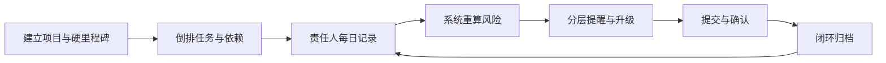
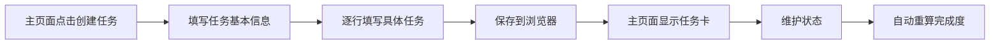
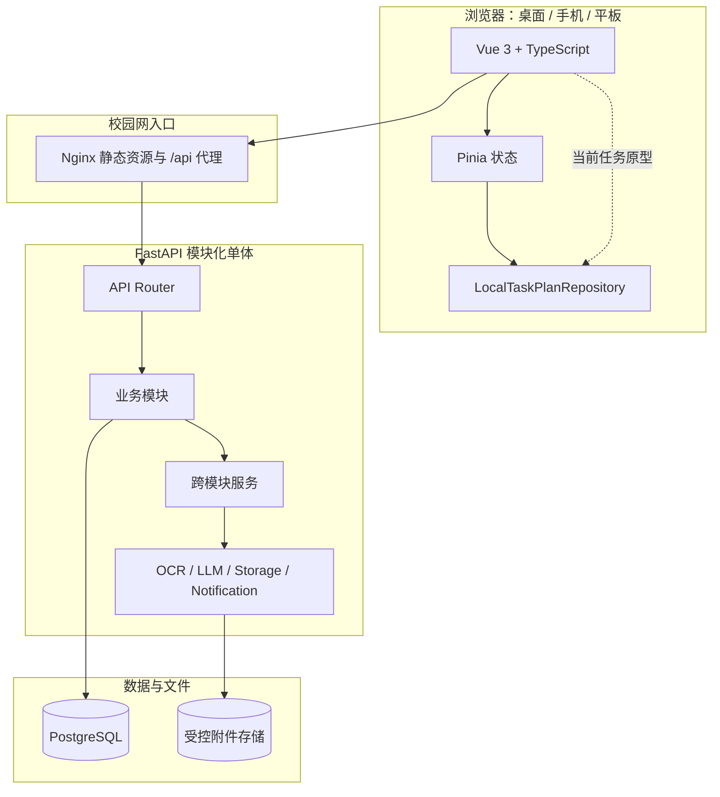
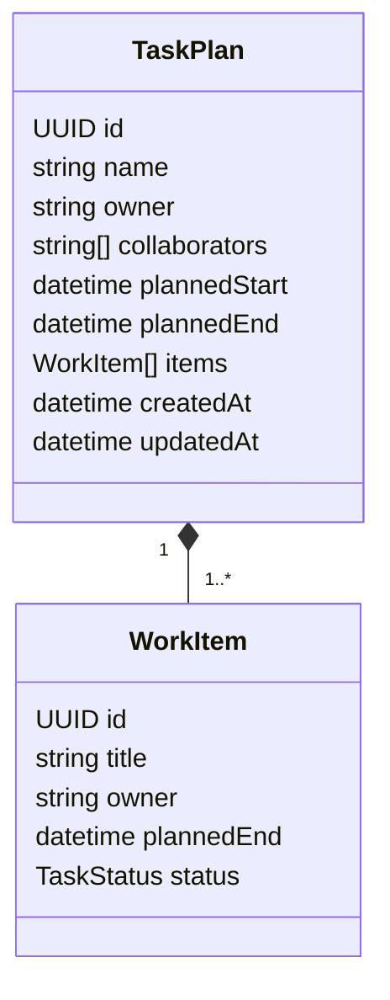
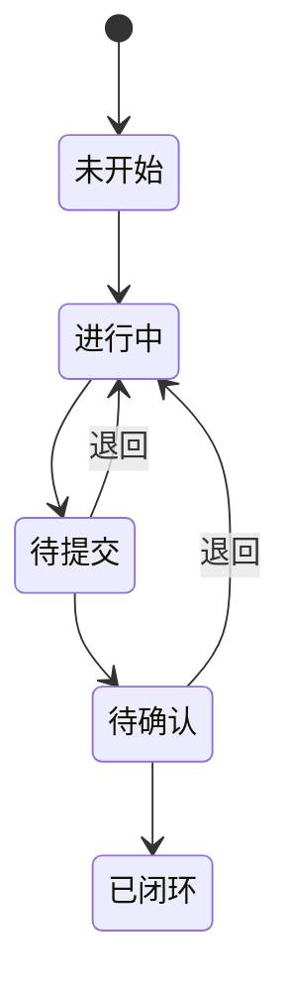
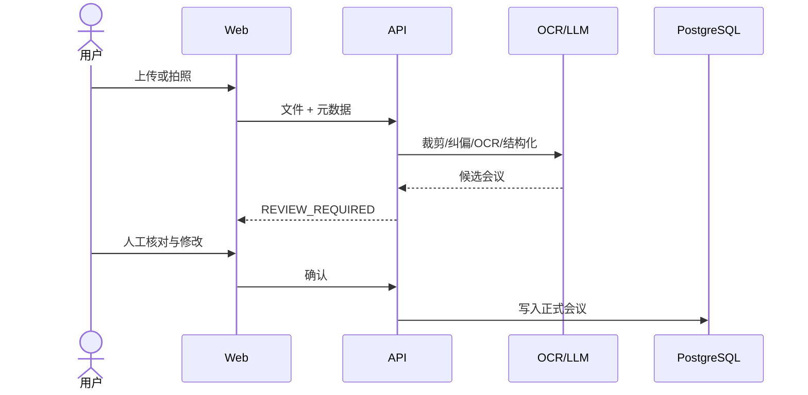

# 后墙（Backwall Tracker）框架设计

> 文档版本：0.2  
> 对应代码版本：0.1.0  
> 当前阶段：可操作的单浏览器任务原型 + 可扩展的前后端工程骨架

## 1. 设计目标

系统服务于空间探测载荷研制过程，核心业务闭环是：



框架首先解决三个问题：

1. **便携记录**：高频操作在浏览器和手机上都能快速完成。
2. **计划、实际和风险分离**：原始承诺、调整计划和实际发生的进展不能互相覆盖。
3. **外部能力可替换**：OCR、大模型、文件存储、通知渠道必须可换成校园网内获准的服务。

本次可运行原型聚焦用户最新指定的最小闭环：



## 2. 当前实现范围

### 2.1 已实现

- 响应式 Web 应用壳：桌面侧边导航、移动端底部导航。
- “今日”主页面：任务统计、任务列表、空状态和创建入口。
- 两步任务弹窗：
  - 第一步：任务名称、负责人、协作人、计划开始时间、计划完成时间；
  - 第二步：逐行填写具体任务、负责人、计划完成时间和任务状态。
- 新建与维护任务。
- 主页面任务卡：
  - 任务名称；
  - 负责人；
  - 协作人；
  - 截止时间；
  - 逾期/完成标记；
  - 完成度；
  - 可展开的具体任务列表。
- 浏览器本地持久化、存储格式版本号、非法缓存容错。
- FastAPI `/api/v1/health` 健康检查。
- SQLAlchemy 异步会话、Alembic 迁移入口。
- PostgreSQL、前后端镜像与 Nginx 反向代理模板。
- OCR、LLM、存储和通知 Provider 协议。

### 2.2 明确未实现

- 本地任务尚未写入后端或 PostgreSQL；
- 用户登录、多用户与项目权限；
- 项目、硬里程碑、依赖、进展记录和附件；
- 风险计算、定时提醒和通知发送；
- 图片/PDF 实际解析；
- 周报生成和导出。

页面中未完成的模块均明确显示为规划占位，不返回“假成功”业务结果。

## 3. 总体技术架构

采用前后端分离、模块化单体。首期不引入微服务，避免在业务边界尚未稳定时增加部署和数据一致性成本。



当前任务页面通过 Repository 接口访问 `localStorage`。下一阶段新增异步 `HttpTaskPlanRepository` 时，主要改动集中在 Repository 和 Store；页面仍使用相同的任务类型与用例动作，不需要理解 Axios、数据库或 SQLAlchemy。

## 4. 目录结构与职责

```text
Backwall_Tracker/
├─ README.md
├─ .env.example
├─ compose.yaml
├─ backend/
│  ├─ pyproject.toml
│  ├─ Dockerfile
│  ├─ alembic.ini
│  ├─ alembic/
│  │  ├─ env.py
│  │  ├─ script.py.mako
│  │  └─ versions/
│  ├─ app/
│  │  ├─ main.py
│  │  ├─ api/
│  │  │  ├─ router.py
│  │  │  └─ v1/router.py
│  │  ├─ core/
│  │  │  ├─ config.py
│  │  │  └─ logging.py
│  │  ├─ db/
│  │  │  ├─ base.py
│  │  │  └─ session.py
│  │  ├─ domain/enums.py
│  │  ├─ modules/
│  │  │  └─ health/
│  │  ├─ models/
│  │  ├─ services/
│  │  ├─ providers/contracts.py
│  │  └─ jobs/
│  └─ tests/test_health.py
├─ frontend/
│  ├─ package.json
│  ├─ vite.config.ts
│  ├─ Dockerfile
│  └─ src/
│     ├─ api/                  HTTP 客户端和服务端契约
│     ├─ components/
│     │  ├─ FeaturePlaceholder.vue
│     │  └─ tasks/
│     │     ├─ TaskPlanDialog.vue
│     │     └─ TaskPlanCard.vue
│     ├─ config/navigation.ts
│     ├─ layouts/MainLayout.vue
│     ├─ repositories/
│     │  └─ taskPlanRepository.ts
│     ├─ router/index.ts
│     ├─ stores/
│     │  ├─ app.ts
│     │  └─ tasks.ts
│     ├─ styles/index.css
│     ├─ types/task.ts
│     ├─ utils/task.ts
│     └─ views/
├─ infra/nginx/default.conf
└─ ref/
   ├─ user_demands.md
   └─ framework_design.md
```

### 4.1 后端分层规则

- `api`：只负责版本化路由汇总。
- `modules`：按业务功能组织 router、schema、service 和必要的数据访问。
- `core`：配置、日志、安全等全局技术能力。
- `db`：数据库引擎、会话和 ORM 基类。
- `models`：经过评审并有迁移文件的 SQLAlchemy 模型。
- `services`：风险、提醒、导入流水线、导出等真正跨模块的编排。
- `providers`：外部系统的抽象协议和具体适配器。
- `jobs`：提醒扫描、导入解析等定时或异步任务入口。

不为每个简单查询提前制造空的 Repository 类。只有在数据访问需要替换、复用或测试隔离时再抽象。

### 4.2 前端分层规则

- `views`：页面级编排，不直接读写 `localStorage`。
- `components`：可复用交互和展示。
- `stores`：页面共享状态和用例动作。
- `repositories`：数据来源边界；当前是本地存储，未来是 HTTP。
- `api`：Axios 实例和后端 DTO。
- `types`：稳定的前端领域类型。
- `utils`：无副作用的格式化和计算函数。

## 5. 当前任务聚合设计

为避免未来与完整项目域中的“任务/子任务”混淆，当前用户创建的一整项工作称为 `TaskPlan`，其中一行一行的执行项称为 `WorkItem`。



任务状态统一为：



代码枚举值保持稳定：

| 中文 | API/存储值 |
|---|---|
| 未开始 | `not_started` |
| 进行中 | `in_progress` |
| 待提交 | `pending_submission` |
| 待确认 | `pending_confirmation` |
| 已闭环 | `closed` |

当前完成度不采用主观阶段权重，计算公式为：

```text
完成度 = 已闭环 WorkItem 数量 / WorkItem 总数量 × 100%
```

例如 4 行中有 1 行已闭环，完成度为 25%。这使卡片百分比可解释，也方便前后端保持一致。

## 6. 新建和维护任务交互

### 6.1 第一步：基本信息

必填：

- 任务名称；
- 负责人；
- 计划开始时间；
- 计划完成时间。

可选：

- 协作人，可自由输入多个姓名。

规则：

- 名称与人员保存前去除首尾空格；
- 完成时间不得早于开始时间；
- 协作人去空、去重，并排除与负责人同名项；
- 点击遮罩不会误关闭弹窗。

### 6.2 第二步：具体任务

每行包含：

- 具体任务；
- 负责人；
- 计划完成时间；
- 任务状态；
- 删除操作。

新增行时负责人默认取总任务负责人，完成时间默认取总任务截止时间，状态默认“未开始”。每行完成时间必须落在总任务计划周期内；至少保留一项有效具体任务后才能保存。

### 6.3 主页面

主页面按总任务截止时间升序显示。卡片必须同时呈现：

- 名称；
- 负责人；
- 截止时间；
- 完成度；
- “已闭环 N / 共 M 项”的解释；
- 逾期或已完成语义；
- 协作人；
- 可展开的具体任务。

## 7. 本地存储策略

存储键：

```text
backwall-tracker.tasks.v1
```

数据使用带版本的 envelope：

```json
{
  "schemaVersion": 1,
  "savedAt": "2026-07-30T13:00:00.000Z",
  "records": []
}
```

`LocalTaskPlanRepository` 在读取时逐项检查：

- 顶层结构；
- 必填字符串；
- 日期可解析性；
- `items` 是否为数组；
- 状态是否在白名单；
- 缺失 ID 时补生成 UUID。

非法 JSON、旧结构或浏览器拒绝写入不会造成白屏。旧版直接数组结构也可读取，然后在下一次保存时升级成 envelope。若浏览器拒绝持久化，任务仍保留在当前页面内存中，同时界面会明确提示“刷新后可能丢失”。

限制：

- 数据仅属于当前浏览器和当前 origin；
- 清理站点数据会丢失；
- 无多用户并发、服务端备份和审计；
- 不允许把附件、密钥或涉密正文放入 localStorage。

## 8. 下一阶段服务端契约

建议保持前端 DTO 与当前模型同构，第一批接口：

| 方法 | 路径 | 用途 |
|---|---|---|
| `POST` | `/api/v1/task-plans` | 原子创建总任务、协作人和所有明细 |
| `GET` | `/api/v1/task-plans` | 主页面分页列表 |
| `GET` | `/api/v1/task-plans/{id}` | 读取详情 |
| `PATCH` | `/api/v1/task-plans/{id}` | 带 revision 的乐观锁更新 |

人员字段最终应从自由文本升级为：

```json
{
  "userId": null,
  "displayName": "张三"
}
```

这样当前原型数据可保留 `displayName`，账户系统上线后再关联 `userId`，无需破坏性迁移。

数据库最小表：

- `task_plans`；
- `task_plan_collaborators`；
- `work_items`。

服务端创建必须在同一事务中完成，日期使用 `timestamptz`，更新使用 `revision` 防止多人覆盖。完成度保持派生值，不落库。

## 9. 完整业务领域模型

后续 PostgreSQL 模型建议包括：

| 领域 | 核心实体 | 关键约束 |
|---|---|---|
| 用户权限 | User、ProjectMember | 系统管理员是全局角色；项目管理员是项目范围角色 |
| 项目计划 | Project、Milestone、ScheduleRevision | 硬里程碑不可被普通任务调整覆盖 |
| 任务执行 | Task、TaskMember、TaskDependency | 父子关系与依赖关系分开；依赖图无环 |
| 每日记录 | DailyUpdate、Attachment | 记录事实，不覆盖历史 |
| 会议 | Meeting、MeetingActionItem | 保留专家意见原文和 PDF 页码 |
| 导入 | ImportJob、ImportCandidate | 模型结果必须进入人工核对状态 |
| 通知 | ReminderEvent、Notification | `dedupe_key` 保证重复扫描不重复发送 |
| 审计 | AuditLog | 状态、计划、人员和确认操作可追溯 |

原计划与调整计划不能只靠不断覆盖两个日期字段。建议将首次批准计划保存为不可变基线，后续每次调整生成 `ScheduleRevision`，包含旧值、新值、原因、操作人和时间。

## 10. “今日”页面长期聚合规则

按行动优先级呈现：

1. 已经逾期；
2. 今天必须完成；
3. 当前被阻塞；
4. 等待我确认；
5. 三天内到期；
6. 其他进行中任务。

记录进展的长期字段：

- 今天完成了什么；
- 实际进度或状态；
- 是否阻塞及原因；
- 下一步工作；
- 附件；
- 是否提交确认。

保存后生成新的 `DailyUpdate`，不可用新内容覆盖昨日事实。

## 11. 风险与提醒扩展点

框架暂不固化未经课题组确认的风险公式。风险服务最终应返回等级和可解释原因，而不只返回颜色：

```text
RiskAssessment
├─ level
├─ affectedMilestone
├─ bufferDays
├─ predictedFinishAt
└─ reasons[]
```

分层提醒规则按需求保留：

| 时间 | 对象 |
|---|---|
| 截止前 7 天 | 责任人 |
| 截止前 3 天 | 责任人、协作人 |
| 截止前 1 天 | 责任人、协作人 |
| 逾期当天 | 责任人、协作人、项目管理员 |
| 持续逾期 | 每日提醒或升级 |

定时扫描必须以任务、规则、日期、接收人生成唯一 `dedupe_key`，从而可重复运行但不重复发送。

## 12. 图片/PDF 导入

### 12.1 会议表图片



### 12.2 会议纪要 PDF

流程为：

`上传 → 文字/扫描判断 → 提取/OCR → 行动项候选 → 人工补齐人员和日期 → 生成闭环任务`

每个行动项保留会议、日期、原文、责任人、配合人、完成日期、提交文件、确认人和原始页码。

出于研制材料安全考虑，`LLM_ALLOW_EXTERNAL` 默认是 `false`。没有显式批准时，Provider 不应向互联网服务发送原文或文件。

## 13. 配置与安全

根目录 `.env.example` 只提供模板，`.env` 已被 Git 忽略。关键变量：

- `DATABASE_URL`（可选完整覆盖）或 `POSTGRES_HOST/PORT/DB/USER/PASSWORD`；
- `SECRET_KEY`；
- `CORS_ORIGINS`；
- `UPLOAD_DIR` / `MAX_UPLOAD_MB`；
- `OCR_PROVIDER`；
- `LLM_PROVIDER` / `LLM_BASE_URL` / `LLM_API_KEY` / `LLM_MODEL`；
- `LLM_ALLOW_EXTERNAL`；
- `TIMEZONE=Asia/Shanghai`。

上传服务后续必须校验 MIME、扩展名、文件头和大小，使用随机存储键，原文件名只作为元数据，并对下载做项目权限校验。

## 14. 本地与校园网部署

开发模式：

```text
Vue/Vite :5173 -- /api 代理 --> FastAPI :8000 --> PostgreSQL :5432
```

校园网容器模式：

```text
浏览器 --> Nginx :WEB_PORT --> 静态 Vue
                         └--> /api --> FastAPI --> PostgreSQL
```

Nginx 已配置 SPA history fallback 和 `/api/` 反向代理。`compose.yaml` 定义数据库、后端、前端、数据库卷和附件卷。

## 15. 测试策略

当前已有/已执行：

- Python `compileall`；
- FastAPI 健康检查测试文件；
- Vue/TypeScript 类型检查；
- Vite 生产构建。

任务交互后续应补 Vitest/Playwright，用例至少包括：

1. 空字段和反向日期被拦截；
2. 增删中间行后数据不串行；
3. 明细时间超出总计划周期被拦截；
4. 两行中一行闭环时完成度为 50%；
5. 刷新后数据仍存在；
6. 非法 localStorage 不白屏；
7. 375px 宽屏幕可完整创建；
8. 连续点击保存不会重复创建。

## 16. 推荐迭代顺序

1. **任务服务端化**：完成 TaskPlan/WorkItem 模型、迁移、CRUD、前端 HTTP Repository 和本地数据迁移。
2. **用户与项目**：登录、RBAC、项目成员、项目管理员和硬里程碑。
3. **每日进展**：Today 聚合、快速记录、阻塞、附件和确认闭环。
4. **计划与风险**：计划版本、依赖、关键路径、风险原因。
5. **提醒**：定时扫描、站内通知、去重和升级。
6. **会议导入**：文件存储、内网 OCR/LLM、人工核对。
7. **周报与部署加固**：导出、审计、备份、监控和校园网发布。

## 17. 待业务确认

- 项目管理员能否修改硬里程碑，是否需要二次审批；
- 风险公式、缓冲时间和关键路径计算口径；
- 待确认任务被退回后的时间责任如何记录；
- 通知渠道及持续逾期升级对象；
- 附件保留期限、容量和涉密级别；
- 周报导出格式；
- 可使用的内网 OCR/大模型服务及其接口规范。
